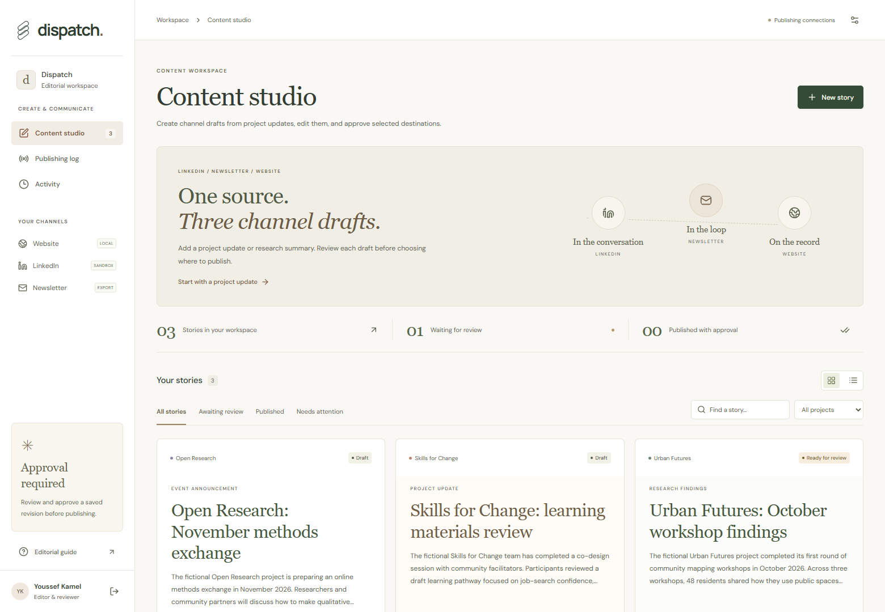
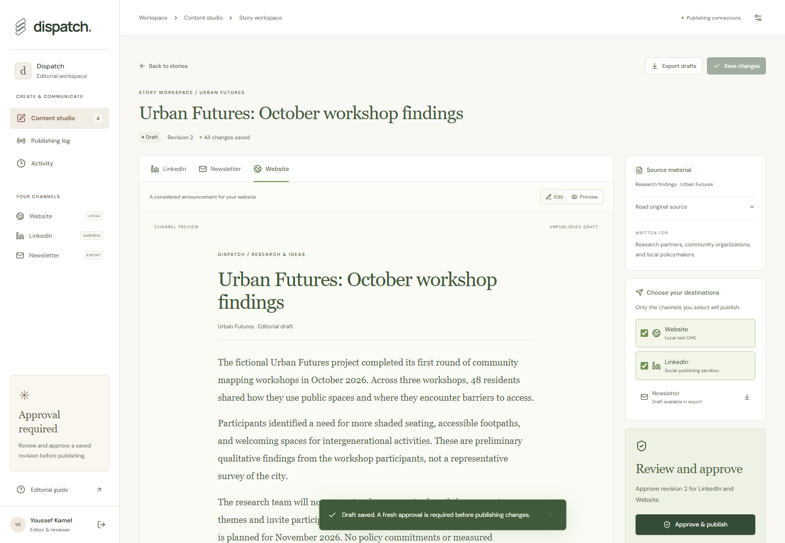
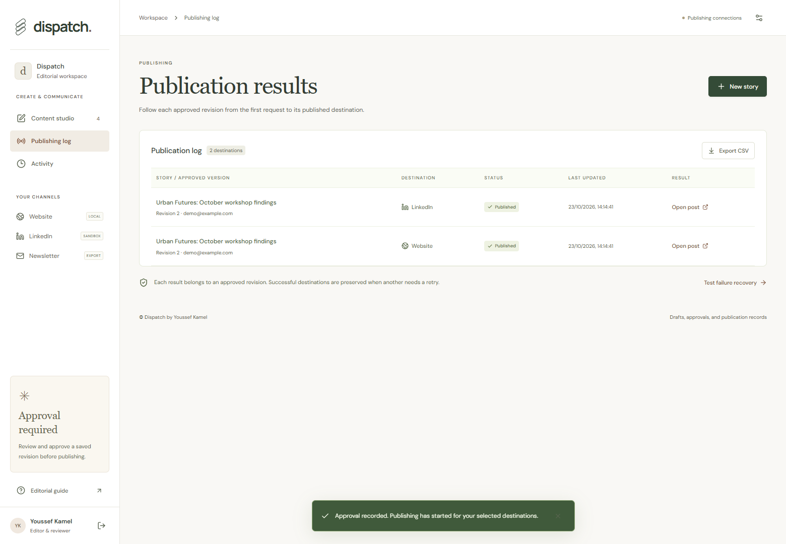
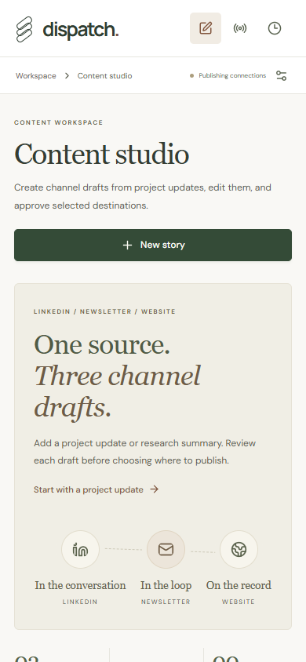
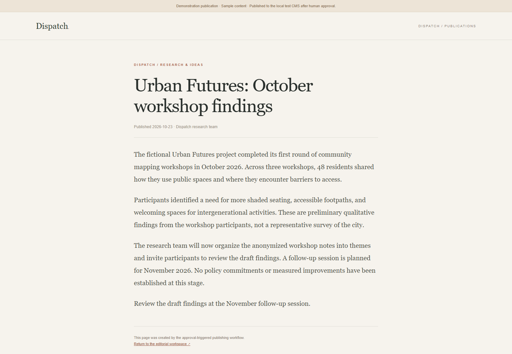

# Dispatch

Source-based drafts, editorial review, and approved publishing.

[Run locally](#run-locally) · [Connections](#connections) · [Development](#development)



Dispatch turns a project update into LinkedIn, newsletter, and website drafts. An editor reviews the text, chooses destinations, and approves a saved revision before the publishing worker sends anything.

| Channel editor | Publication results |
| --- | --- |
|  |  |

## Features

- Import a JSON/text source file or write an update directly.
- Edit three channel drafts without losing the original source or earlier revisions.
- Approve the exact saved text and selected destinations; later edits require a new approval.
- Publish to the built-in website/social sandbox or configure WordPress and LinkedIn adapters.
- Track result IDs, URLs, timestamps, failures, and targeted retries.

<details>
<summary>Mobile view and published article</summary>
<br>



</details>

## Run locally

Requirements: Python 3.11+ and Node.js 20.19+ or 22.12+.

On Windows:

```powershell
git clone https://github.com/YoussefKamelKamel1/dispatch-studio.git
cd dispatch-studio
.\setup.ps1
.\start.ps1
```

Open **http://127.0.0.1:8012** and choose **Open fictional demo workspace**.

Demo login: `demo@example.com` / `demo-password`. Three unpublished example updates are included. **New story → Import source file** accepts the reusable files in [`examples/`](examples/).

For macOS/Linux:

```bash
python -m venv .venv
source .venv/bin/activate
pip install -r requirements.txt
cd frontend
npm ci
npm run build
cd ..
python run.py
```

FastAPI serves the interface, API, local website, and social sandbox from the same address. Interactive API documentation is at `/docs`.

## Connections

Copy `.env.example` to `.env`, add the relevant settings, and restart. The connection panel reports configuration status and provides read-only checks. Secrets remain on the server.

| Connection | Default | Configuration |
| --- | --- | --- |
| Draft generation | Labeled local template | `OPENAI_API_KEY`, `OPENAI_MODEL`, `AI_MODE` |
| Website | Built-in local CMS | `WEBSITE_PROVIDER=wordpress`, `WORDPRESS_URL`, `WORDPRESS_USERNAME`, `WORDPRESS_APPLICATION_PASSWORD` |
| LinkedIn | Local social sandbox | `SOCIAL_PROVIDER=linkedin`, `LINKEDIN_ACCESS_TOKEN`, `LINKEDIN_AUTHOR_URN`, `LINKEDIN_API_VERSION` |
| Newsletter | Editable draft and text export | Email distribution is not connected. |

**OpenAI:** `AI_MODE=auto` enables live generation when a key is supplied. `demo` always uses local templates; `live` requires a key and never silently falls back. The model must support the configured structured-output schema. Existing example drafts retain their original provider label.

**WordPress:** use the HTTPS site root and an Application Password for an account with `publish_posts` permission. The adapter uses the site's standard `/wp-json/wp/v2/posts` endpoint. It publishes the approved text and stores the returned ID/link. The connection check verifies authentication and account permissions without creating a post.

**LinkedIn:** provide a token authorized for the selected person or organization URN. Personal posts need `w_member_social`; organization posts need `w_organization_social` and an eligible page role. The text-only adapter uses the Posts API and version headers. Tokens are supplied manually; OAuth registration, consent callbacks, and automatic refresh are not included. Combined title/body must fit 3,000 characters.

Credentials and provider permissions must be supplied separately for each external service. The adapters have HTTP contract tests; real account access and external publication remain unverified until configured and exercised. The built-in website and social sandbox require no external publishing account.

### Approval and recovery

Approval records the reviewer, revision, content fingerprint, channels, and frozen destination configuration. Jobs commit in the same transaction. A changed connection cannot redirect an old approved job.

Local receivers use persisted idempotency keys. Partial failures preserve successful destinations. WordPress can reconcile an uncertain result by its deterministic slug and exact approved content. An uncertain LinkedIn write requires manual feed verification; Dispatch never automatically repeats that ambiguous create request.

## Development

**Stack:** React, TypeScript, Vite, FastAPI, SQLite, Pydantic, Playwright.

```bash
python -m pytest -q --basetemp=.test-tmp
cd frontend
npm run build
```

For browser checks, start a fresh local workspace and run the suite from `frontend/`:

```bash
python run.py --data-dir data/browser-test
# In another terminal:
cd frontend
npm run test:e2e
```

The browser suite uses Microsoft Edge on Windows and Chromium on other systems. Install Chromium with `npx playwright install chromium` when needed. Checks cover source-file import, editable previews, explicit approval, local publication, partial failures, retries, mobile layout, and automated accessibility. CI uses local templates and publishing destinations.

```text
backend/          API, drafts, approvals, publishing jobs, and adapters
frontend/src/     React studio and channel editor
tests/            Workflow and connector contract tests
examples/         Reusable source files and prepared draft examples
sample-outputs/   Example draft exports and publication results
docs/screenshots/ Application screenshots
```

This is a local single-reviewer application. A public deployment needs organizational authentication, managed secrets and storage, token lifecycle management, and a queue suitable for its worker topology.

---

Created by [Youssef Kamel](https://github.com/YoussefKamelKamel1).
